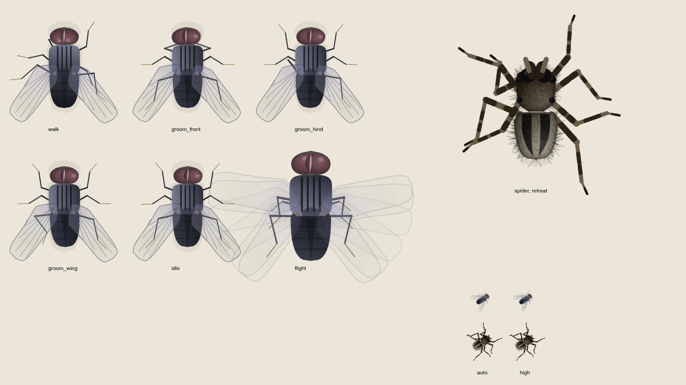

# Myxa.js

**[Live demo](https://hnatt.github.io/myxajs/demo/)**

A house fly walks around on your web page. It wanders, stops to rub its front
feet together, cleans its wings with a hind leg, takes off, darts across the
page and lands somewhere else. Bring the pointer near it and it hurries off;
move at it quickly and it takes off before you get close.

And a jumping spider hunts it from the edges of the page.

It all lives on one transparent canvas over the page. The canvas never catches
a click and never takes focus, so the page underneath works exactly as before.



## Quick start

One script tag:

```html
<script src="myxa.min.js" data-autostart></script>
```

Options go in data attributes, named as in the [options table](#options) but
in kebab case:

```html
<script src="myxa.min.js" data-autostart data-flies="2" data-spider="false"></script>
```

Or as a module:

```js
import { Myxa } from './myxa.esm.js';

const toy = Myxa.start({ flies: 2, shyness: 1.5 });
```

`dist/myxa.min.js` (classic script, exposes `window.Myxa`; the autostarted toy
is `window.myxa`) and `dist/myxa.esm.js` (ES module) have no dependencies.

## API

```js
const toy = Myxa.start(options);   // create and start; same as new Myxa(options).start()

toy.set({ speed: 1.5 });           // change options while it runs
toy.pause();                       // freeze in place
toy.resume();
toy.stop();                        // remove the canvas and every listener

toy.running;                       // false before start, after stop, or if reduced motion stopped it
toy.reducedMotion;                 // true if it declined to start because of prefers-reduced-motion
```

`set` applies at once to every option except `canvas`, `container` and `seed`,
which only take effect on a fresh `start`.

## Options

| option | default | |
|---|---|---|
| `flies` | `1` | how many flies |
| `flySizeMm` | `7` | body length in millimetres; a house fly is about 7 |
| `speed` | `1` | speed multiplier for everything that moves |
| `spider` | `true` | the jumping spider that hunts from the edges |
| `spiderSizeMm` | `9` | spider body length in millimetres |
| `cursor` | `true` | whether the fly is afraid of the pointer |
| `shyness` | `1` | scales every distance at which the pointer spooks the fly |
| `behaviour` | see below | what a fly on the ground does next, as relative weights |
| `stray` | `true` | a walking fly may wander part-way off the edge of the page |
| `excursions` | `true` | a flying fly now and then leaves the page for a moment |
| `respawnDelay` | `[10, 60]` | seconds before a new fly turns up after one is eaten |
| `shadow` | `true` | soft contact shadows |
| `fps` | `60` | frame-rate cap; 30 halves the cost, 0 removes the cap |
| `detail` | `'auto'` | `'low'` skips fine detail, `'high'` forces it, `'auto'` decides by size on screen |
| `maxDpr` | `2` | cap on device pixel ratio |
| `pxPerMm` | `96 / 25.4` | CSS pixels per millimetre (the CSS reference density) |
| `seed` | random | for a repeatable fly |
| `duration` | none | stop and remove itself after this many seconds |
| `canvas` | none | draw into this canvas instead of creating a full-page overlay |
| `container` | `document.body` | where the created overlay is appended |
| `zIndex` | `2147483647` | stacking order of the created overlay |
| `ignoreReducedMotion` | `false` | start even if the visitor prefers reduced motion |

`behaviour` defaults to

```js
{ walk: 0.40, groomFront: 0.16, groomHind: 0.12, groomWing: 0.08, idle: 0.14, takeOff: 0.10 }
```

Real flies groom a great deal. Set a weight to `0` to rule a behaviour out:
`{ takeOff: 0 }` gives a fly that only flies when frightened.

Sizes are in real millimetres, so a 7 mm fly is about 26 CSS pixels long.

## Staying out of the way

* **Click-through.** The canvas has `pointer-events: none`, so every click,
  scroll, selection and drag goes to the page underneath. Hit-testing at the
  fly's position finds the page element, not the canvas.
* **Never takes focus.** No tabindex, nothing focusable, and it is
  `aria-hidden` so screen readers skip it.
* **Reads the pointer, never handles it.** Pointer listeners are passive and
  never call `preventDefault` or `stopPropagation`. The page sees exactly the
  events it would have seen anyway.
* **Reduced motion.** If the visitor has `prefers-reduced-motion: reduce`, it
  does not start, unless you pass `ignoreReducedMotion`.
* **Cheap.** Only the boxes around the animals are cleared and redrawn each
  frame, never the whole canvas. Static outlines are built once. The spider's
  fur is drawn once per size and blitted after that. Fine detail (bristles,
  wing veins, speckle) is skipped when it would be smaller than a pixel.
  Animation stops while the tab is hidden. In headless Chromium with software
  rasterisation, three flies and the spider together take 1–2 ms a frame.
  A GPU-backed canvas costs less.

## Behaviour

`walk` → `idle` → `groom front feet` → `groom abdomen` → `wipe wings` →
`take off` → `flight` → `landing`, chosen at random with fly-like weightings.

**Walking** uses a real alternating-tripod insect gait. The feet are planted
on the page and the two tripods swing alternately, each leg solved by two-bone
inverse kinematics. The legs push against the surface instead of looping a
canned animation.

**Take-off** is immediate. A house fly's take-off is over in roughly 50 ms
with the wings already at full stroke, so there is no beetle-like spreading
and pausing.

**Flight** is house-fly flight. The fly is driven along its own body axis, so
it always travels nose-first and never hovers or drifts backwards. It changes
course in *saccades*, about ten quick 30–50 ms flicks a second, and keeps
turning gently in between, which rounds its path off. It looks a third of a
second ahead and flicks back before it would leave the page.

**The pointer.** A fly's escape reflex is driven by *looming*: how soon
something will arrive, not just how far away it is. That is why swatting
slowly rarely works. The fly judges the pointer on time-to-contact as well as
distance:

* park the pointer about 2 cm away and it walks off, away from it;
* come within about 1 cm, or move at it fast, and it takes off early and
  flies faster than usual, towards the part of the page furthest from the
  pointer;
* in the air it veers away, and it will not land next to the pointer.

`shyness` scales all of these distances; `cursor: false` turns the fear off.

### The spider

A jumping spider lives on the borders of the page. Jumping spiders don't build
webs. They stalk:

* **lurk**: sit still and watch, palps waggling;
* **patrol**: work along the edge;
* **stalk**: creep along the edge towards the point nearest the fly, freezing
  now and then. While the fly is in the air it holds still and follows it with
  its whole body, turning no faster than about 150°/s and with a little wobble,
  so it lags a fast fly rather than tracking like a turret;
* **pounce**: leap, from about seven body lengths out;
* **retreat**: walk back to the border;
* **hide**: slip over the edge and out of sight, and come back out at the edge
  nearest the fly.

**How it walks.** A spider's knee bends upward, so from above each leg is a
nearly straight spoke from body to foot, and the eight legs stay evenly fanned
out. Each leg sweeps only a small arc. Steps follow the alternating tetrapod
(legs I and III of one side with II and IV of the other), with a wave running
back to front along each side, so the legs ripple rather than lifting four at
once. A leg flicks forward quickly and stays planted for most of the cycle. A
leg nearing the end of its reach steps early if its neighbours are down. When
the spider stops, a raised foot finishes its step and comes down. It walks in
short dashes with pauses, as jumping spiders do. Each joint casts a shadow
from its own height, so a lifted foot visibly leaves its shadow. Its palps
waggle almost constantly, and it flexes its chelicerae every few seconds.

The fly ignores a spider creeping up from a distance, which is why the stalk
works, but it answers a leap by bolting into the air. Its escape reflex has a
latency of a few tens of milliseconds, and that margin is the spider's whole
chance: the fly gets away from roughly nine leaps in ten.

When the spider does connect, it follows the real capture sequence:

* **seize**: the fly is gripped in the front legs and bitten. It thrashes,
  wings buzzing, and the struggle dies away over a second or two as the venom
  works;
* **haul**: the spider walks *backwards* to cover with its fangs still in the
  fly, holding it out in front;
* **feed**: right off the page, out of sight. Ten seconds to a minute later
  another fly arrives.

Flies always arrive on the wing from beyond the edge of the page. They never
appear out of nowhere.

### Drawing

Both animals are drawn procedurally on the canvas, not loaded from sprites,
so there are no assets and they stay sharp at any pixel density. Proportions
and colours are measured from reference photographs: the fly's head, thorax
and abdomen are 0.21, 0.35 and 0.44 of its length, with the four black thorax
stripes and the big red-brown eyes of *Musca domestica*. The spider has a dark
carapace, a cream abdomen with two bold black stripes, and banded legs. The
highlight is re-lit as each animal turns, so it always sits towards the same
light.

## Development

```
npm install          # esbuild, the only dev dependency
npm test             # behaviour tests, headless
npm run build        # dist/myxa.esm.js and dist/myxa.min.js
npm run demo         # then open http://localhost:8000/demo/
npm run check:browser -- http://localhost:8000/demo/   # end-to-end check in headless Chromium
```

The demo page has live controls for most options. `demo/gallery.html` draws
both animals large and still. The tests run the simulation for simulated
minutes at a time: flight is nose-first and saccadic, legs stay in reach,
the spider keeps to the border and usually misses, a capture runs seize →
haul → feed, and the fly reacts to the pointer as described above.
`check:browser` drives a real browser and confirms that clicks pass through
the fly, focus is never taken, and the frame cost stays low.

### Layout

| file | |
|---|---|
| `src/fly.js` | the fly's behaviour, gait, pose and fear of the pointer |
| `src/fly-render.js` | the fly, drawn in Canvas 2D |
| `src/spider.js` | the spider's edge patrol, stalk, pounce and capture |
| `src/spider-render.js` | the spider, with cached fur |
| `src/overlay.js` | the click-through canvas and dirty-rect clearing |
| `src/pointer.js` | passive pointer tracking |
| `src/myxa.js` | options, animation loop and public API |
| `src/world.js`, `src/random.js`, `src/util.js` | page geometry, seeded RNG, maths |

## License

MIT
